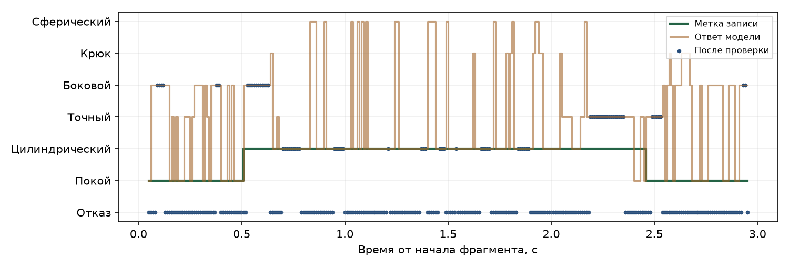

# Уверенный хват

Распознавание хватов по поверхностной ЭМГ с проверкой команд. Технический отчёт для студенческого кейса СТЕПЛАЙФ, SK Challenge 2026.

## 1. Что предлагается

Задача проекта - распознавать пять хватов и состояние покоя по сигналам мышц предплечья. Между классификатором и контроллером кисти добавлена проверка команды. Система может отказаться от сомнительного решения и дождаться подтверждения. Проверяется, уменьшает ли это число ошибочных переключений и какой ценой по задержке и отказам.

Выполнен первый программный эксперимент на реальной записи NinaPro DB2 одного участника. Реализованы загрузка, причинная фильтрация, признаки, обучение LDA и SVM, проверка команд и сохранение результатов. Привод к программе не подключался. Требование не более 100 мс от сокращения мышцы до движения пока не выполнено и не подтверждено.

## Съём сигнала

Для аппаратного прототипа предлагается восемь дифференциальных каналов ЭМГ вокруг сохранившейся части предплечья. Зоны интереса - сохранившиеся поверхностные сгибатели пальцев и кисти, а также разгибатели. Конкретные точки выбираются после проверки активности у пользователя. Восемь каналов не означают восемь отдельных наклеек: число контактов зависит от схемы дифференциальных электродов и общего электрода.

Нельзя предполагать наличие мышц кисти или использовать дистальный костный ориентир, который отсутствует после ампутации. Кольцевая манжета упрощает повторную установку, но сама по себе не гарантирует устойчивость к повороту или смещению.

Частота дискретизации - 2 кГц на канал. Перед цифровой обработкой нужен аналоговый тракт с подавлением наложения спектров. Полезная для выбранного конвейера полоса ограничивается 20-450 Гц. При 24-битном представлении поток восьми каналов составляет 2000 × 8 × 3 = 48 000 байт/с без служебных данных.

В эксперименте используются первые восемь из двенадцати каналов DB2 [1]. Они расположены вокруг предплечья. Запись здорового участника позволяет проверить программу, но не доказывает её применимость к конкретному пользователю протеза.

# Обработка и проверка команды

## 2. Схема системы

Электроды → усилитель и АЦП → причинный фильтр → окно 50 мс → 40 признаков → LDA / SVM → проверка команды → связь → контроллер привода → начало движения.

Проверка исходного сигнала подаёт отдельный флаг на проверку команды. При плохом сигнале выдаётся запрет движения. Аппаратная часть от электродов до АЦП и участок от связи до привода пока описаны как проект; эксперимент начинается с записанного цифрового сигнала.

## Фильтры и признаки

Применяются полосовой фильтр Баттерворта и режекторный фильтр 50 Гц. Фильтр сохраняет состояние между блоками и использует только уже поступившие отсчёты. Обучение и тест используют одинаковую обработку. Дополнительные режекторные фильтры на гармониках не включены без оценки их необходимости.

Из окна 50 мс с шагом 10 мс вычисляются MAV, WL, ZC и SSC, а также RMS. Для восьми каналов получается 40 признаков. Порог ZC и SSC равен 1% RMS соответствующего канала; это фиксированный параметр данного опыта, а не универсальный оптимум. Окно 50 мс выбрано как исходная гипотеза для малого времени реакции.

## Проверка решения

Модель выдаёт оценки шести классов. Лучшая оценка сравнивается с порогом. Новый класс принимается после N совпадающих решений подряд. После отказа или пропуска данных подтверждение начинается заново. Покой рассматривается как отдельный класс и не означает автоматическое раскрытие кисти.

Порог и N выбираются на валидации. В первом опыте для SVM получились порог 0,5 и N = 3, для LDA - 0,7 и N = 1. Проверка разницы двух лучших оценок поддерживается модулем, но в этом опыте выключена, чтобы не добавлять ещё один настраиваемый параметр.

Проверка качества сигнала обнаруживает почти постоянный канал и слишком большой разброс амплитуды относительно обучения. Это простая эвристика. Она не определяет причину помехи и не заменяет аппаратную проверку контакта или насыщения АЦП.

При отказе возвращаются command = None и inhibit = True. Контроллер привода должен явно остановить движение; пропуск отправки не должен оставлять в исполнении старую команду сжатия. На стороне привода нужен независимый таймер отсутствия данных.

# Данные и сравнение моделей

## 3. Протокол первого эксперимента

Использован файл S1_E2_A1.mat из NinaPro DB2. Это один участник без ампутации. Выбраны пять движений упражнения C, по шесть повторений каждого: всего 30 фрагментов. В каждый фрагмент включено до 0,5 с соседнего покоя до движения и после него. Другие движения удаляются как целые фрагменты и не склеиваются.

| Класс проекта | Движение C | Метка DB2 |
|---|---|---|
| Цилиндрический | 2: Small diameter grasp | 19 |
| Точный | 15: Tip pinch grasp | 32 |
| Боковой | 17: Lateral grasp | 34 |
| Крюк | 3: Fixed hook grasp | 20 |
| Сферический | 10: Power sphere grasp | 27 |
| Покой | Rest | 0 |

Соответствие выбрано по официальной таблице движений [2]. Повторения 1, 3 и 4 используются для обучения, 2 - для настройки порогов, 5 и 6 - для итогового теста. Это разделение по повторениям одного человека, а не проверка в другой день или на новом пациенте.

Фильтрация начинается заново в каждом фрагменте. Первые 200 мс и окна со сменой метки исключаются только из обучения. В тесте переходы сохранены, а истинный класс берётся по последнему доступному отсчёту. Окна одного повторения не попадают в разные части выборки.

## LDA и SVM

LDA с регуляризацией даёт линейную границу между классами. SVM с RBF-ядром допускает нелинейную границу, но обычно требует больше вычислений. В обоих случаях используется StandardScaler. Оценки калибруются сигмоидным методом на трёх группах обучающих повторений; валидация и тест в калибровке не участвуют.

На валидации перебираются пороги 0; 0,5; 0,7; 0,85; 0,95 и 1-3 подтверждения. Минимизируется сумма доли ошибочных выданных команд, 0,2 доли отказов и 0,1 доли пропущенных движений. Такой критерий не задаёт жёсткий предел отказов. Получившийся режим оценивается как исследовательский, а не готовый для использования.

# Результаты на реальной ЭМГ

## 4. Тест: повторения 5 и 6, один участник

| Показатель | LDA | SVM |
|---|---|---|
| Точность модели | 48,7% | 55,4% |
| Macro-F1 модели | 0.432 | 0.500 |
| Ошибки среди принятых команд, после проверки | 49,1% | 24,4% |
| Отказы после проверки | 94,9% | 66,1% |
| Движения без правильной команды | 3 из 10 | 2 из 10 |

Для подробного разбора ниже показана SVM. Сравнение проводится на одном и том же потоке из 4574 окон, при одинаковой проверке сигнала.

| Режим SVM | Ошибочные переключения | Отказы | Ошибки среди выданных |
|---|---|---|---|
| Без проверки решения | 535 | 0,0% | 44,6% |
| Только порог | 118 | 47,1% | 34,0% |
| Только подтверждение | 201 | 19,1% | 39,7% |
| Порог и подтверждение | 43 | 66,1% | 24,4% |

Ошибочных переключений стало меньше: 535 → 43. Одновременно доля отказов достигла 66,1%, а два движения не получили правильную команду. Поэтому уменьшение переключений не означает, что управление стало достаточно удобным. Для LDA проверка отклонила 94,9% окон; такой режим также непригоден для практического управления.

Показан первый тестовый фрагмент в порядке исходного файла. Отказ выделен отдельным уровнем. Цифры относятся только к выбранным хватам участника S1. Синтетический запуск сохранён отдельно и не используется как доказательство качества на людях.

# Задержка и ограничение 100 мс

## 5. Что измерено

Время от разметки начала движения до первой правильной команды измерено на отложенных повторениях. Это программная оценка по метке restimulus, а не измерение физиологического начала сокращения датчиком. Время связи и механики в неё не входит.

| SVM | Без проверки | С проверкой |
|---|---|---|
| Медиана первой правильной команды | 175 мс | 225 мс |
| 95-й процентиль | 671 мс | 846 мс |
| Правильная команда за 100 мс | 4 из 10 | 3 из 10 |
| Нет правильной команды за движение | 0 из 10 | 2 из 10 |

Медиана и 95-й процентиль считаются только для движений с правильной командой. Пропуски приведены рядом. Исключать их из выводов нельзя. Ограничение 100 мс в этом эксперименте не достигнуто уже на программном уровне.

## Вычисления на компьютере

| Этап | SVM, 95-й процентиль |
|---|---|
| Причинная фильтрация блока 10 мс | 0,1 мс |
| Буфер и признаки | 0,1 мс |
| Калиброванная SVM | 2,8 мс |
| Проверка команды | 0.014 мс |
| Вся вычислительная итерация | 3,0 мс |

Замеры выполнены на macOS, arm64, Python 3.12. Это не результаты STM32. Процентили отдельных этапов не складываются в точный процентиль суммы. Время вычислений мало по сравнению с наблюдаемым временем до правильного решения.

## Бюджет для следующей аппаратной версии

Проектные ориентиры: накопление информативного участка - до 50 мс; ожидание шага - до 10 мс; подтверждение трёх решений - 20 мс при трёх подходящих ответах подряд; фильтр, признаки и модель - до 5 мс вычислений на целевой плате; связь - до 2 мс. Сумма этих ориентиров 87 мс оставляет 13 мс на остальные задержки, включая тракт съёма и начало движения. Это напряжённый бюджет, а не подтверждённый результат.

Окно 50 мс не гарантирует распознавание за 50 мс: после начала движения может потребоваться больше данных. Отдельно следует измерить задержку аналогового и цифрового фильтров и привода. Следующий опыт должен сравнить длины окон по валидации и проверить их на новых данных [3].

# Адаптация и сбор данных

## 6. План проверки на людях

Следующий этап - записи 8-12 пользователей протезов при участии профильной лаборатории. Для каждого: пять хватов, отдельный покой, десять повторений каждого хвата в течение трёх визитов. Плановый объём активных фрагментов: 8-12 × 5 × 10 × 3 = 1200-1800. Такой объём является планом пилотного исследования, а не расчётом достаточной клинической выборки.

Повторение: около 3 с попытки хвата и не менее 3 с отдыха; при утомлении пауза увеличивается. Записи распределяются между несколькими положениями предплечья. Манжета переустанавливается между визитами. Сохраняются номер визита, конфигурация электродов и замечания о качестве сигнала. Контакт с кожей выполняется через подходящий изолированный тракт с батарейным питанием; прямое подключение к сетевой аппаратуре недопустимо.

## Персональная настройка

Перед использованием собирается небольшой размеченный набор пользователя. Обучаются масштабирование и классификатор, затем выбираются пороги. Продолжительность настройки и необходимое число примеров измеряются отдельно. Обещать достаточность одной минуты калибровки по текущим данным нельзя.

Оценка проводится в двух режимах. В первом модель проверяется на человеке, чьи данные не использовались при обучении. Во втором допускается фиксированная калибровка нового пользователя, а тест проводится на другом визите. Параметры подбираются без доступа к тестовым данным. Для DB3 требуется отдельный протокол с учётом различий числа каналов и сохранившихся мышц [4].

## Усталость, пот и положение руки

Эти условия могут менять распределение сигнала. В проекте предусмотрены журнал качества каналов, запрос повторной калибровки и обучение на нескольких положениях руки. Добавление шума или изменения усиления в программе проверяет устойчивость к выбранному искажению, но не считается полноценной моделью пота или усталости.

Автоматическое дообучение по собственным ответам модели пока не включено. Уверенный неправильный ответ может закрепить ошибку. В дальнейшем можно исследовать адаптацию с ограниченным обновлением и возможностью возврата к предыдущей модели, сравнивая её с настройкой по размеченным примерам.

## Что показывать специалисту

План интерфейса: амплитуда и качество каждого канала, две лучшие оценки модели, принятая команда, причина отказа и журнал смены хватов. Важность признака нельзя напрямую называть вкладом конкретной мышцы. Карта каналов нужна для диагностики установки, а матрица ошибок - для выбора движений для повторной записи.

# Оборудование и сроки

## 7. Аппаратная версия

Для первого стенда рассматривается ADS1298 - восьмиканальный 24-битный аналоговый тракт - и плата STM32H743 с Cortex-M7 [5, 6]. Между ними используется SPI, таймер задаёт дискретизацию. Выбор платы не доказывает производительность всей системы: необходим перенос фильтров и модели, измерение времени, памяти и питания.

Калиброванные модели в Python используют ансамбль из трёх экземпляров. Для микроконтроллера потребуется отдельно проверить упрощённую модель и её калибровку. Перенос не сводится к копированию Python-кода. До готовности платы демо работает на компьютере с записанным сигналом и виртуальными командами.

## Предварительный бюджет стенда

| Статья | Плановый лимит, ₽ |
|---|---|
| Тракт съёма, плата, защита и изоляция | 35 000 |
| Электроды, манжета и кабели | 12 000 |
| Отладочная плата и интерфейсы | 10 000 |
| Приводы с драйверами | 30 000 |
| Механика и печать | 35 000 |
| Питание, платы и сборка | 20 000 |
| Расходники и повторные итерации | 18 000 |
| Итого | 160 000 |

Это распределение бюджета, а не проверенные предложения поставщиков. До закупки нужны спецификация и актуальные цены. Не включены зарплата, клиническое исследование, сертификация и покупка измерительных приборов; предполагается доступ к лаборатории. Резерв до предела задания 200 000 ₽ составляет 40 000 ₽.

## План на 3-6 месяцев

Первый месяц: расширить проверку на открытых записях, сравнить длины окон, уточнить схему и спецификацию. Второй: собрать и проверить тракт съёма. Третий: записать пилотные данные и настроить персональную калибровку. Четвёртый: перенести выбранную модель на плату. Пятый и шестой: подключить механику, проверить задержку, отказы и поведение при потере связи.

Критерий перехода к испытанию с приводом - предсказуемая остановка, независимый таймер команд, подтверждённые электрические ограничения и приемлемая работа на новых записях. Текущий эксперимент этот этап не заменяет.

# Выводы и источники

## 8. Что показывает первая версия

Реализован воспроизводимый программный опыт с пятью хватами и покоем. Проверка команды действительно уменьшила число ошибочных переключений в выбранной записи, но сопровождалась большим числом отказов. При текущих параметрах управление нельзя считать достаточно надёжным или быстрым.

Для продолжения важнее улучшить распознавание на коротких окнах и проверить результат на новых людях и сессиях, чем повышать порог до почти полного отказа от команд. Нужен критерий выбора параметров с явным ограничением доли отказов и времени реакции, а затем отдельный тест без повторной настройки.

Идея отклонять ненадёжные решения уже применяется в исследованиях [7]. Самостоятельная часть проекта - реализация обработки и контроля команды, сравнение вариантов на фиксированных данных и анализ цены уменьшения ошибок. Новизна мирового уровня не заявляется.

## Воспроизведение

В репозитории находятся исходный код, тесты, таблицы каждого решения, metrics.json и скрипт загрузки DB2. Данные NinaPro не распространяются вместе с проектом. Для запуска: python scripts/download_db2.py; grip-experiment --data data/S1_E2_A1.mat --output results/db2_s1. Разбиение и параметры записаны в файле результатов.

## Источники

[1] NinaPro DB2: состав данных, частота дискретизации и расположение каналов. https://ninapro.hevs.ch/instructions/DB2.html

[2] Официальная таблица движений NinaPro, упражнения A-D. https://ninapro.hevs.ch/figures/SData_Movements.png

[3] Smith et al. Determining the optimal window length for pattern recognition-based myoelectric control: balancing the competing effects of classification error and controller delay. https://pmc.ncbi.nlm.nih.gov/articles/PMC4241762/

[4] NinaPro DB3: записи участников с ампутацией предплечья. https://ninapro.hevs.ch/instructions/DB3.html

[5] Texas Instruments. ADS1298: описание и документация. https://www.ti.com/product/ADS1298

[6] STMicroelectronics. STM32H743/753. https://www.st.com/en/microcontrollers-microprocessors/stm32h743-753.html

[7] Decision-change Informed Rejection Improves Robustness in Pattern Recognition-based Myoelectric Control. https://arxiv.org/abs/2409.14169

[8] SK Challenge 2026, студенческий кейс СТЕПЛАЙФ. https://kids.sk.ru/skkidschallenge

Дата подготовки: 25 сентября 2026. Статус: первый эксперимент, рабочая версия проекта.
